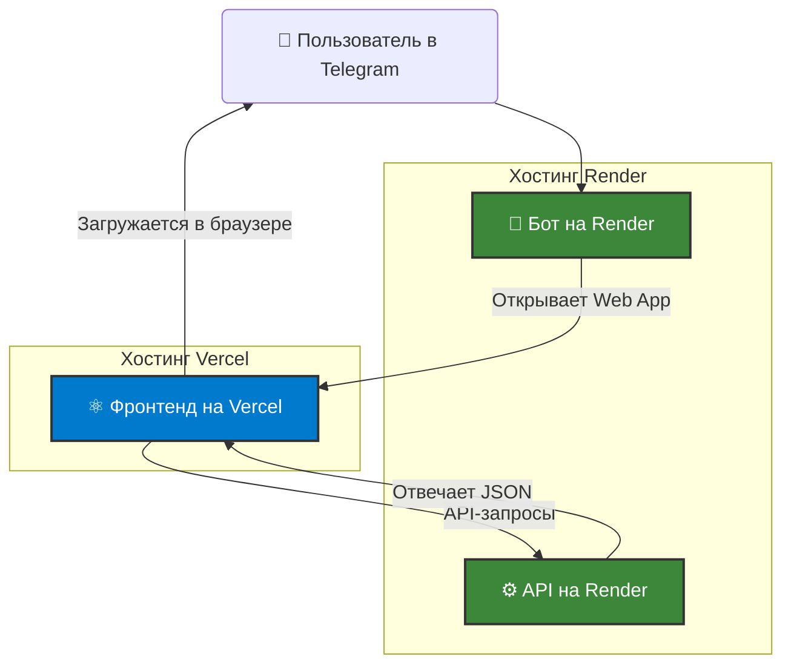

# Интерактивный тренажер для собеседований

**Telegram-бот с интегрированным React-приложением для подготовки к техническим интервью по фронтенду.**

Этот проект был создан как полноценное fullstack-приложение, демонстрирующее современные подходы к разработке, тестированию, автоматизации и развертыванию.


---

### 🏛️ Архитектура развертывания

Проект развернут с использованием **гибридного подхода**, leveraging the strengths of two leading platforms for modern web applications:

- **Frontend (Vercel):** Клиентское React-приложение размещено на **Vercel**. Это обеспечивает молниеносную доставку статических файлов пользователям по всему миру через глобальную Edge Network, а также автоматическую сборку и деплой при каждом коммите.

- **Backend (Render):** Бэкенд на Node.js, включая API и Telegram-бота, развернут на **Render** как "Web Service". Это позволяет поддерживать постоянно работающий процесс для Telegram-бота (в режиме Long Polling) и одновременно обслуживать API-запросы от клиентского приложения.

Такое разделение является стандартной практикой для масштабируемых fullstack-приложений, позволяя независимо разрабатывать, развертывать и масштабировать клиентскую и серверную части.



---

### 🎯 О проекте

Идея проекта — создать удобный инструмент для ежедневной подготовки к собеседованиям. Вместо поиска вопросов в интернете, пользователь может в любой момент открыть Telegram, запустить тренировку и проверить свои знания по ключевым темам фронтенда.

### ✨ Ключевые фичи

- **Интеграция с Telegram:** Запуск сессии происходит через Telegram-бота, который открывает веб-приложение (Web App) прямо в интерфейсе мессенджера.
- **Интерактивный квиз:** Полноценное SPA-приложение на React для прохождения теста.
- **Серверная логика:** Все вопросы, сессии и проверка ответов управляются бэкендом на Node.js, что обеспечивает безопасность и "умное" поведение.
- **Управление сессиями:** Бэкенд отслеживает прогресс пользователя в рамках одной сессии, исключая повторение вопросов.
- **Подсчет очков:** Моментальная обратная связь и подсчет правильных ответов.

---

### 🛠️ Стек технологий

#### Frontend
| Технология | Описание |
|---|---|
| **React** | Библиотека для построения пользовательского интерфейса. |
| **TypeScript** | Строгая типизация для надежности и масштабируемости кода. |
| **Vite** | Современный и быстрый сборщик для разработки. |
| **React Router** | Для навигации в SPA. |
| **@twa-dev/sdk** | Для интеграции с Telegram Web Apps. |

#### Backend
| Технология | Описание |
|---|---|
| **Node.js** | Среда выполнения JavaScript на сервере. |
| **Express** | Минималистичный фреймворк для создания API. |
| **TypeScript** | Для написания надежного и поддерживаемого серверного кода. |
| **Telegraf** | Библиотека для создания Telegram-ботов. |

#### Тестирование и DevOps
| Технология | Описание |
|---|---|
| **Vitest** | Фреймворк для юнит- и компонентного тестирования. |
| **React Testing Library** | Для тестирования React-компонентов с фокусом на поведении пользователя. |
| **MSW (Mock Service Worker)** | Для мокирования API-запросов в тестах. |
| **Concurrently & wait-on**| Для оркестрации и автоматизации запуска нескольких сервисов одной командой. |
| **ngrok** | Для создания публичного туннеля к локальному серверу для отладки Telegram Web App. |
| **ESLint + Prettier** | Для поддержания единого стиля и качества кода. |
| **Vercel** | Платформа для автоматического развертывания и хостинга проекта. |

---

### 🚀 Локальный запуск

Для локальной разработки и отладки используется гибридный подход, имитирующий production-архитектуру.

**Пререквизиты:**
- Node.js (v18+)
- npm
- [ngrok](https://ngrok.com/download) (скачанный и подключенный к вашему аккаунту)

**1. Клонируйте репозиторий:**
```bash
git clone https://github.com/ВАШ_НИК/interview-simulator.git
cd interview-simulator
```

**2. Установите все зависимости:**
```bash
# Эта команда установит зависимости и для клиента, и для сервера
npm install
```

**3. Настройте `.env`:**
- Перейдите в папку `server` и создайте файл `.env`.
- Добавьте в него только токен вашего бота:
  ```env
  # server/.env
  BOT_TOKEN=12345:ABC-DEF1234...
  ```

**4. Запустите всё одной командой:**
Откройте **два терминала**.

**В первом терминале (для `ngrok`):**
```bash
# Эта команда создаст публичный HTTPS-туннель до вашего локального фронтенда
ngrok http https://localhost:5173
```
Скопируйте полученный HTTPS-адрес (например, `https://abcdef.ngrok-free.app`).

**Во втором терминале (для всех сервисов):**
```bash
# Эта команда параллельно запустит API, бота и клиент
npm run dev
```
Дождитесь, пока все сервисы (`API Server`, `Telegram bot`, `Vite`) успешно запустятся.

**5. Свяжите бота с `ngrok`:**
- Откройте файл `server/src/core/bot.ts`.
- Временно вставьте скопированный `ngrok`-адрес в константу `webAppUrl`:
  ```typescript
  // server/src/core/bot.ts
  const webAppUrl = 'https://abcdef.ngrok-free.app';
  ```
- **Сохраните файл.** `ts-node-dev` автоматически перезапустит бота.

**6. Отправьте боту `/start` в Telegram.**

> **Примечание:** На бесплатном тарифе `ngrok` генерирует новый адрес при каждом перезапуске, поэтому шаг 5 придется повторять. Для автоматизации этого процесса в коде оставлена (но закомментирована) функция `getWebAppUrl`, которая может динамически получать URL через API `ngrok`.

---

### 🏆 Что делает этот проект особенным?

Этот проект был написан с упором на практики, принятые в коммерческой разработке:

- **Архитектура Feature-Sliced Design:** Код на фронтенде организован по бизнес-сущностям, а не по техническим типам, что упрощает масштабирование.
- **Комплексное тестирование:** Приложение покрыто тестами на нескольких уровнях (unit, component, integration), что гарантирует его надежность.
- **CI/CD:** Проект настроен на автоматическое развертывание на Vercel при каждом пуше в `main`.
- **Профессиональная гигиена Git:** Используется подход с созданием веток для каждой фичи (`feat/...`), написанием осмысленных коммитов (Conventional Commits) и проверкой кода через Pull Requests.
- **Автоматизация окружения:** Процесс локального запуска всех сервисов автоматизирован одной командой, включая динамическое получение URL от `ngrok`.
- **Современный стек:** Использование TypeScript как на клиенте, так и на сервере, а также современных инструментов вроде Vite и Vitest.
